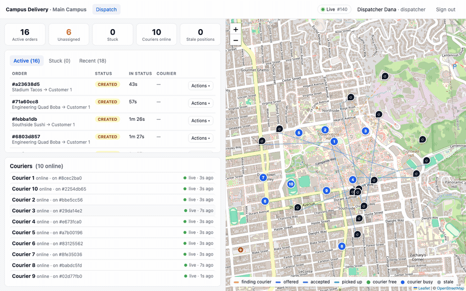
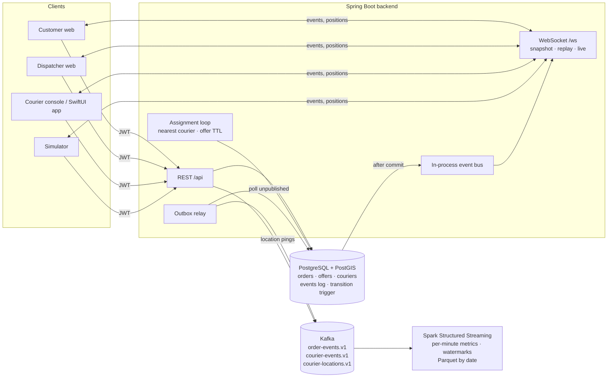
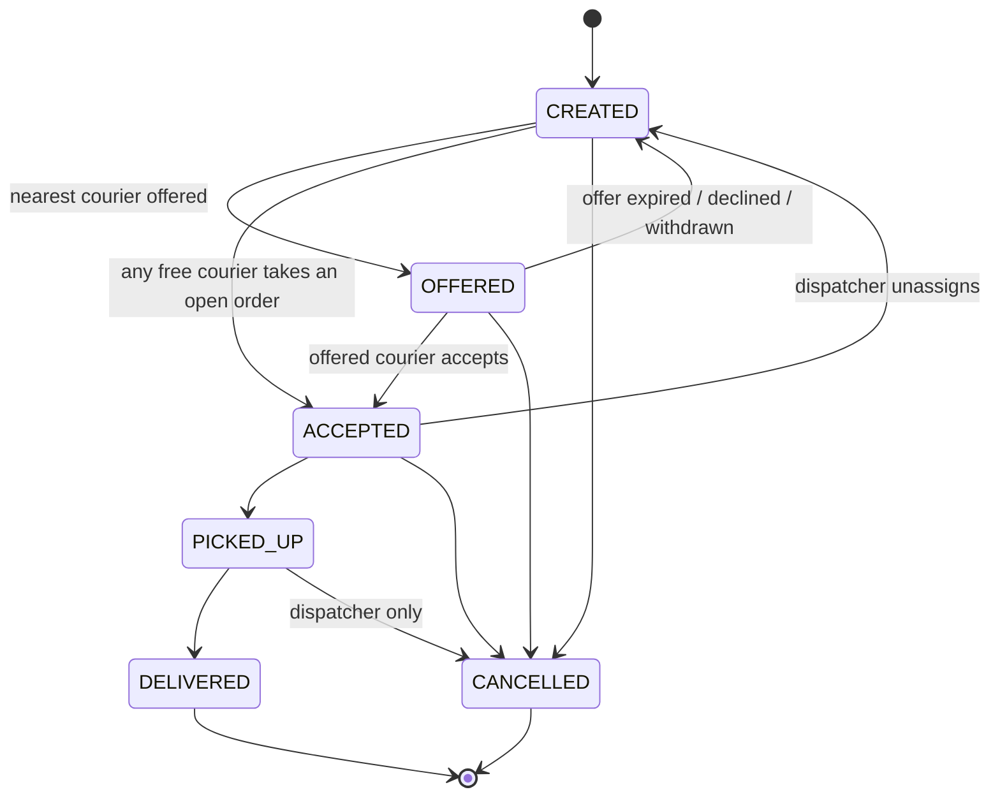

# Campus Delivery

Order → courier accept → live tracking → dispatcher visibility, built to stay correct under
concurrent access and flaky networks.

- **Backend**: Java 21, Spring Boot 3.5 (REST + WebSocket), PostgreSQL 16 + PostGIS, Kafka (KRaft)
- **Web**: React 19 + TypeScript (Vite), Leaflet maps — customer app, dispatcher dashboard, and a courier console
- **Simulator**: TypeScript couriers/customers that drive the public API (out-of-order pings, ignored offers, idempotent retries)
- **Analytics**: PySpark 4.1 Structured Streaming over the Kafka topics → per-minute metrics as date-partitioned Parquet ([analytics/](analytics/README.md))
- **Courier app**: SwiftUI + MapKit + Core Location (planned, after the web flow)

```bash
docker compose up --build
```



| URL                          | What                                              |
|------------------------------|---------------------------------------------------|
| http://localhost:3000        | Web app (sign in as any seeded account below)     |
| http://localhost:8080        | API, `/ws`, `/actuator/health`                    |
| `localhost:5432`             | Postgres `campus`/`campus`/`campus`               |
| `localhost:29092`            | Kafka (EXTERNAL listener for host tools)          |
| `analytics/data/compose/`    | Parquet metrics written by the streaming job      |

Seeded accounts (password `password`): `dispatcher@campus.test`, `customer1..3@campus.test`,
`courier1..20@campus.test`. The simulator logs in as `courier1..10` and `customer1..3`, so sign in as
`dispatcher@campus.test` to watch the map fill up, or as `customer1@campus.test` to place an order and
follow the courier. `courier11@campus.test` and up are free for the courier console.

## Measured behavior

This is a local demonstration using synthetic accounts and data. Development
credentials in Compose are examples; change them before exposing any service.

- One winner from 20 concurrent courier accepts; one order from 10 same-key retries.
- Local Spark replay: 120,464 source records in 20 seconds, approximately 6k records/s,
  including JVM startup. This is replay throughput, not live API capacity.
- Finished-order-to-lifecycle-row latency: 5.24 s p95 across 17 local orders.
  Watermarked minute aggregates have a separate delay; see [measurement details](analytics/README.md).

Fresh October 27, 2026 checks passed backend compilation, the web build,
simulator typechecking, and six analytics batch tests. Docker was stopped locally,
so backend integration and Kafka streaming tests were not rerun locally that day.
The [CI workflow](.github/workflows/ci.yaml) runs those suites on disposable containers;
consult Actions for the actual hosted-run status.

## Architecture



One transaction per state change: take the order row lock, validate, update (the database trigger
re-validates the transition), append an event row. After commit the event fans out to WebSocket
sessions in-process and the outbox relay copies it to Kafka.

## The hard properties

| Property | How it is enforced | Test |
|---|---|---|
| **Exactly one courier per order** | `SELECT … FOR UPDATE` on the order in `OrderService.accept`; losers see `ACCEPTED` and get `409`. Backstop: partial unique index `orders(courier_id) WHERE status IN ('ACCEPTED','PICKED_UP')` so a courier can never hold two active orders. | `ConcurrentAcceptIT` fires 20 concurrent accepts: 1×200, 19×409, one row in the DB. |
| **Idempotent order creation** | `Idempotency-Key` header, `UNIQUE (customer_id, idempotency_key)` and `INSERT … ON CONFLICT DO NOTHING RETURNING id`. Retries return the same order with `200` + `Idempotency-Replayed: true`; same key with a different body is `422`. | `IdempotentOrderCreationIT`: sequential retry, 10 concurrent retries → one order, one `ORDER_CREATED` event. |
| **Location updates** | Batched `POST /api/courier/locations`. Every valid ping is stored and streamed to Kafka; the last-known marker only moves if the ping's device timestamp is newer than what the DB holds (`CourierRepository.updateLastKnown`). Staleness is computed from server receipt time, so clock skew cannot fake freshness. | `LocationUpdatesIT`: `[t3,t1,t2]` batch → marker at `t3`; a later `t0` batch does not move it; future points rejected; `stale` flips after silence. |
| **Reconnect** | Every event has a monotonic id. Clients `subscribe` with `lastEventId`; the server replays the gap (or sends a snapshot if the gap is too large), holding back live events until the replay is flushed. An advisory lock makes event ids commit in order, so "id > lastEventId" cannot skip a late-committing row. | `WebSocketReconnectIT`: drop the socket, create/accept orders, reconnect → the exact missed events in order, then live. Gap > limit → snapshot. Customers only see their own orders. |
| **Assignment** | `AssignmentService` ticks every second: expires timed-out offers (order returns to the pool, courier is put on a per-order cooldown) and offers each `CREATED` order to the nearest online, fresh, free courier via `ST_DWithin` + `ST_Distance` on the GiST-indexed geography column. `FOR UPDATE SKIP LOCKED` makes multiple instances safe. | `AssignmentIT`: nearest gets it, ignores it, next-nearest gets it after the TTL; decline re-offers; out-of-radius/offline couriers never see it. Dispatcher reassign + stuck list. |
| **State machine** | `order_transitions` table + `BEFORE UPDATE` trigger raising SQLSTATE `CD001` on any illegal transition; also bumps `version` and `status_changed_at`. Application code never bypasses it. | `StateMachineIT` issues raw `UPDATE`s and asserts the trigger rejects them. |
| **Auth** | HS256 JWT issued by `/api/auth/login`, roles `CUSTOMER` / `COURIER` / `DISPATCHER` mapped to route groups; WebSocket handshake validates `?token=`. | Every IT logs in per role; `WebSocketReconnectIT` rejects a bad token. |



An `OFFERED` order is exclusive to the offered courier until the TTL passes; a `CREATED` order (no
candidate nearby, or waiting for the next tick) may be taken by any free courier from the "open
orders nearby" list.

## Live feed protocol

`ws://host/ws?token=<jwt>` — JSON text frames.

```
client → {"type":"subscribe","lastEventId":123}        lastEventId optional
server → {"type":"snapshot","lastEventId":N,"orders":[…],"couriers":[…]}
server → {"type":"event","id":N,"eventType":"ORDER_ACCEPTED","orderId":…,"payload":{"order":{…}}}
server → {"type":"resumed","lastEventId":N,"replayed":k,"couriers":[…]}
server → {"type":"location","courierId":…,"lat":…,"lng":…,"recordedAt":…,"receivedAt":…}
client → {"type":"ping"}   server → {"type":"pong"}
```

Scope is derived from the JWT: dispatchers see everything, customers see events for their orders
(including their courier's positions), couriers see offers and orders assigned to them. Position
frames are ephemeral (not replayed); positions are re-sent as part of `snapshot`/`resumed`. The web
client applies an order only if its `version` is not older than the one it has, so duplicates and
reordering across a reconnect are harmless.

## API

| Method & path | Role | Notes |
|---|---|---|
| `POST /api/auth/login` | – | `{email,password}` → `{token,user}` |
| `GET /api/merchants`, `GET /api/config` | any | merchants; campus center + tunables |
| `POST /api/customer/orders` | customer | header `Idempotency-Key` required; `201` new / `200` replay |
| `GET /api/customer/orders[/{id}]` | customer | includes courier last-known position + `stale` |
| `POST /api/customer/orders/{id}/cancel` | customer | until `PICKED_UP` |
| `POST /api/courier/status` | courier | `{status: ONLINE|OFFLINE}`; going offline withdraws a pending offer |
| `POST /api/courier/locations` | courier | `{points:[{lat,lng,recordedAt,…}]}` up to 200 |
| `GET /api/courier/me`, `/orders`, `/orders/open`, `/orders/history` | courier | |
| `POST /api/courier/orders/{id}/accept|pickup|deliver` | courier | `409` codes: `order_unavailable`, `offered_to_other_courier`, `courier_busy`, `courier_offline` |
| `POST /api/courier/offers/{id}/decline` | courier | |
| `GET /api/dispatch/orders`, `/orders/stuck?olderThanSeconds=`, `/orders/{id}`, `/couriers` | dispatcher | |
| `POST /api/dispatch/orders/{id}/cancel` | dispatcher | `{reason, expectedVersion?}` → `409 version_mismatch` on stale version |
| `POST /api/dispatch/orders/{id}/reassign` | dispatcher | `{courierId?, expectedVersion?}`; no courier = back to pool |

Errors are RFC 9457 problem details with a machine-readable `code`.

## Kafka and analytics

Topics and JSON schemas live in [`contracts/`](contracts/README.md). Order and courier events go
through a transactional outbox (`events.published_at`), keyed by aggregate id, at-least-once with
`eventId` for dedupe. Courier pings are fire-and-forget telemetry on `courier-locations.v1`.

[`analytics/`](analytics/README.md) consumes both topics with Spark Structured Streaming and writes
Parquet partitioned by date: per-minute order event counts and time-to-accept, exact active orders
per minute, courier utilization, one row per finished order, and quarantine tables for bad records.
Watermarks bound late data, `eventId` dedupe absorbs outbox redelivery, and the checkpoint plus the
file sink's metadata log make output exactly-once. A streaming test against a Kafka container
proves that a restart writes nothing twice, that two replays over the same offsets are identical,
and that a replay from a per-partition offset yields exactly the suffix. Measured end-to-end
latency is in the analytics README.

## Project layout

```
backend/    Spring Boot service — src/main/resources/db/migration/V1__schema.sql is the schema
  ├─ orders/      OrderService (all state changes), repositories, customer/courier/dispatch controllers
  ├─ assignment/  AssignmentService loop, OfferRepository (ST_DWithin query)
  ├─ couriers/    status + location batches
  ├─ events/      event log, outbox relay, telemetry publisher, in-process bus
  ├─ ws/          WebSocket handler, replay/snapshot service, JWT handshake
  └─ src/test/    integration tests (Testcontainers: PostGIS + Kafka)
web/        Vite + React: src/pages/{customer,dispatcher,courier}, src/live (store + reconnecting socket)
simulator/  tsx script: simulated couriers and customers
analytics/  PySpark streaming job (delivery_analytics/stream.py), batch job, latency report, tests
contracts/  Kafka topic schemas
```

## Development

```bash
# infra only
docker compose up postgres kafka

# backend (hot reload via your IDE, or:)
cd backend && JAVA_HOME=$(/usr/libexec/java_home -v 21) mvn spring-boot:run

# web on http://localhost:5173 (proxies /api and /ws to :8080)
cd web && npm install && npm run dev

# simulated couriers against the local backend
cd simulator && npm install && COURIERS=6 ORDERS_PER_MINUTE=6 npm start
```

Tests need Docker (Testcontainers pulls `postgis/postgis:16-3.5` and `apache/kafka:4.1.2`):

```bash
cd backend && JAVA_HOME=$(/usr/libexec/java_home -v 21) mvn test
```

```bash
cd analytics && JAVA_HOME=$(/usr/libexec/java_home -v 21) .venv/bin/python -m pytest
```

Tunables (env → `application.yml`): `APP_OFFER_TTL` (20s), `APP_ASSIGNMENT_RADIUS_M` (3000),
`APP_LOCATION_STALE_AFTER` (30s), `APP_DISPATCH_STUCK_AFTER` (3m), `APP_CAMPUS_LAT/LNG/NAME`,
`APP_JWT_SECRET`, `APP_SEED_PASSWORD`, `SIM_COURIERS`, `SIM_ORDERS_PER_MINUTE`.

## Design notes

- **Row lock, not optimistic retry, for accept.** Contention on one order is short and the loser
  needs a definitive "no", not a retry loop. `version` still exists and dispatcher actions can send
  `expectedVersion` to refuse acting on a stale view.
- **Monotonic event ids.** `bigserial` alone allows a smaller id to commit after a larger one; a
  client resuming from the larger id would miss it. `EventRepository.append` takes a transaction-scoped
  advisory lock right before `nextval`, serializing only the tail of event-producing transactions.
- **Outbox vs. telemetry.** Business events must not be lost, so they go through the database. Pings
  are frequent and self-healing (the next one supersedes), so they are published directly with a short
  `max.block.ms`; Kafka being down never fails a courier's request.
- **Staleness from receipt time.** A courier whose clock is wrong cannot look fresh, and an old
  device timestamp still proves the device is alive.
- **JWT in the WebSocket URL.** Browsers cannot set handshake headers. Tokens are short-lived and the
  handshake is the only request carrying it in a URL; a one-time ticket endpoint is the upgrade path.
- **PostGIS image.** `postgis/postgis` publishes amd64 only; Compose pins `platform: linux/amd64`
  (Rosetta on Apple Silicon) — set `POSTGIS_IMAGE=imresamu/postgis:16-3.5` for native arm64.

## Out of scope / next

Payments, a routing engine and push notifications are out of scope. Next: the SwiftUI courier app
(same REST + WebSocket contract as the courier console), MinIO + Airflow around the batch job, a
metrics table served back to the dispatcher dashboard, and deployment through the Reliability Lab
pipeline.
